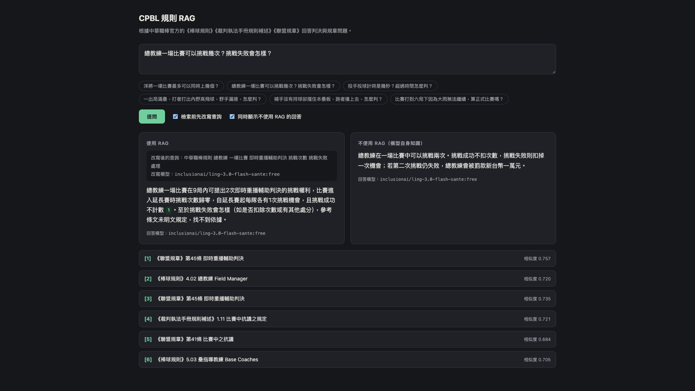

# CPBL Rules RAG

[](README.md)
[](README_zh-TW.md)

A small demo project that shows how to build a RAG (retrieval-augmented generation) application with LangChain and Qdrant, served by FastAPI and run entirely under Docker Compose.

What it demonstrates:

- Splitting documents along their own structure, and giving every chunk a citation header
- Rewriting the user's question before retrieval
- Streaming an answer whose citations link back to the source page
- Showing the same question answered with and without retrieval, side by side
- Switching LLM provider through configuration alone

The knowledge base is only an example: the official rule documents of the CPBL (Chinese Professional Baseball League, Taiwan). Ask about a game situation or a regulation, and the app retrieves the relevant articles and answers with the article number, the page number and a link to the official PDF. Nothing in the approach is specific to baseball. The parts tied to this corpus are the document definitions in `app/corpus.py`, the prompts in `app/rag.py` and the sample questions in the UI.

Because the corpus is in Traditional Chinese, so are the prompts and the web UI, and questions should be asked in Chinese.

## What it looks like

The same question answered with retrieval (left) and without it (right), with the retrieved articles listed below:



Here the answer on the left quotes the league regulation: two challenges in nine innings. The one on the right, from the same model without the documents, makes up a rule about earning a third.

Two more examples:

- [The pitch timer](docs/screenshots/pitch-timer.png): two documents give different numbers, and the answer reports both along with their sources. The figures are those of the 2024 supplement, the newest edition the league has published.
- [A colloquial question about a catcher blocking home plate](docs/screenshots/home-plate-collision.png): the query is rewritten into rulebook terms and the answer follows rule 6.01(i), exceptions included. It also shows a retrieval weakness: all six chunks come from that one rule, so the league's own supplement on home plate collisions (item 3.26), which is stricter about those exceptions, is never retrieved and the answer is incomplete. The screenshot predates the per-article cap described under Design decisions, which was added because of this case.

## Quick start

1. Create the config file, then open `.env` and fill in `OPENROUTER_API_KEY`. The default is a free model, which has a daily request limit (see the note below); `.env.example` lists the other providers.

   ```bash
   cp .env.example .env
   ```

2. Build the image.

   ```bash
   docker compose build
   ```

3. Download the PDFs and build the index. This takes about 2 minutes and starts Qdrant on its own.

   ```bash
   docker compose run --rm api python -m app.ingest
   ```

4. Start the app.

   ```bash
   docker compose up -d
   ```

> **Free model quota.** As of September 2026, OpenRouter limits free models to 50 requests per day per account, or 1000 once the account has bought 10 credits, and to 20 per minute. These figures can change; the [OpenRouter limits page](https://openrouter.ai/docs/api-reference/limits) has the current ones. One question sends up to 3 requests (query rewrite, RAG answer, no-RAG answer), so at 50 a day the free quota covers about 16 questions. Unticking the comparison or the rewrite option saves one request each. When the quota runs out, the UI shows `Rate limit exceeded: free-models-per-day` until the next day.

The index is built before the API starts, so the app is usable as soon as it is up. It is kept in a volume, so ingest only needs to run again when the documents, the chunking or the embedding model change.

- Web UI: http://localhost:8000
- API docs: http://localhost:8000/docs
- Qdrant dashboard: http://localhost:6333/dashboard

For development, run `docker compose up --watch`; changes under `app/` or `frontend/` are synced into the container.

## Corpus

All three documents come from the [official CPBL site](https://www.cpbl.com.tw/). `ingest` downloads them into `data/`:

| Document | Content | Split unit |
|---|---|---|
| 棒球規則 (Official Baseball Rules, 2026) | The playing rules and the definitions of terms | Rule number (`5.07`), definition entry (`INFIELD FLY`) |
| 裁判執法手冊規則補述 (Umpire Manual Rule Supplement) | The league's interpretations of how rules apply to specific situations | Item number (`3.26`) |
| 聯盟規章 (League Regulations, 2026) | Competition rules, player registration, penalties and so on | Article (`第45條`) |

The documents are copyrighted by the CPBL and marked as not for reproduction, so `data/` is kept out of version control. When the league publishes a new edition, run `python -m app.ingest --refresh`. If the download fails, the site has most likely changed a file URL; update it in `app/corpus.py`.

## How it works

```
Indexing (app/ingest.py)
  PDF ─→ extract text per page, drop page numbers and running headers
      ─→ group into articles by article number ─→ split over-long articles into chunks
      ─→ prepend a citation header to each chunk ─→ embed ─→ Qdrant

Question answering (POST /api/chat, streamed as SSE)
  question ─→ LLM rewrites it in rulebook terminology
           ─→ search once for the original and once for the rewrite, fuse the two rankings,
              keep the top k with at most three chunks per article
           ─→ number the chunks and put them in the prompt
           ─→ LLM streams the answer, citing sources as [1][2]
```

The same flow as a sequence diagram: [docs/rag-sequence.mmd](docs/rag-sequence.mmd).

## Code tour

| File | Responsibility |
|---|---|
| `app/corpus.py` | URLs and layout rules for the three documents (regexes for page numbers, running headers and article numbers), plus downloading |
| `app/parsing.py` | Text cleaning and splitting; pure functions only |
| `app/vectorstore.py` | The LangChain adapter for fastembed, and the Qdrant connection |
| `app/ingest.py` | The indexing command |
| `app/rag.py` | Prompts, query rewriting, retrieval and merging |
| `app/main.py` | FastAPI endpoints |
| `frontend/index.html` | Single-page UI with no build step |

## API

| Endpoint | Description |
|---|---|
| `GET /api/search?q=&k=` | Retrieval only; returns chunks with similarity scores. Use it to see the effect of changing the chunking or the embedding model |
| `POST /api/chat` | Takes `{question, use_rag, rewrite, top_k}` and streams `rewrite`, `sources`, `token`, `model` and `error` events as SSE. `rewrite` and `model` carry the name of the model that actually responded |

```bash
curl --get localhost:8000/api/search --data-urlencode "q=延長賽最多打幾局" | jq '.[] | {section, title, score}'
```

## Design decisions

**Split by article number, not by fixed length.** The article is the semantic unit of a rule document, and citations need the article number. `RecursiveCharacterTextSplitter` is applied only when a single article exceeds `CHUNK_SIZE`.

**Every chunk starts with its citation**, for example `《棒球規則》5.09 出局｜5.09(b) 跑壘員出局`. Once a long article is split, the later chunks no longer show which article they belong to. Chapter 6 of the supplement is the clearest case: it lists the rulings that can be changed and the rulings that cannot, and without the header the items of the two lists are indistinguishable.

**Rewrite the query before retrieving.** Fans say 洋將 (foreign player), 挑戰 (challenge) and 擋壘 (blocking the base); the rulebook says 外國籍球員, 即時重播輔助判決 and 妨礙跑壘. To see the difference, untick 檢索前先改寫查詢 ("rewrite the query before retrieving") in the UI and ask 「洋將一場比賽最多可以同時上幾個？」 (how many foreign players can be on the field at once).

**Merge the two searches by rank, and cap what one article contributes.** The original question and its rewrite are searched separately and combined by reciprocal rank fusion. Similarity scores from different queries are not comparable, and ranking the union by score let a rewrite that went astray push out the original question's best hits. Then at most three chunks per article are kept, because a long rule split into many similar chunks would otherwise fill every slot and crowd out a shorter, equally relevant item from another document. Both are trade-offs measured on the sample questions, not guarantees: a cap of two dropped the chunk that holds the pitch timer figures, and even with both in place the league's home plate collision item was retrieved for only 5 of 8 rewrites collected for that question.

**LangChain as the integration layer.** It is the most widely used stack for LLM applications, so the code here looks like what most RAG projects look like and carries over to them. Its shared interfaces also make the LLM a configuration choice: `init_chat_model` turns `LLM_MODEL` into the right client, so moving between Anthropic, OpenAI and OpenRouter models is a change to `.env` only. The text splitter and the Qdrant integration come ready-made. The cost is an extra layer between this code and the actual API calls, which is the reason for the next decision.

**LangChain components, but not its chains or agents.** The chat model, embeddings, vector store and text splitter all go through LangChain interfaces, so switching provider or vector database is a change in one place. The flow itself is three plain functions in `app/rag.py`, so what each step sends is always visible.

**Qdrant as the vector database.** It runs as a single container, which suits a Compose setup, and it ships with a dashboard for browsing the stored chunks and their metadata, which is useful when learning how retrieval behaves. Its client has an in-memory mode, which the API tests use in place of a running server. It also supports sparse vectors natively, leaving room to add hybrid search later. The alternative considered was pgvector. That is the better fit when an application already needs PostgreSQL for relational data, but this demo stores nothing except the chunks.

**The LLM and the vector store are injected as FastAPI dependencies.** Tests replace them through `dependency_overrides` with a fake LLM and an in-memory Qdrant, so the whole flow runs without an API key or any external service.

## Swapping components

- **LLM**: change `LLM_MODEL` in `.env` (format `provider:model`) and supply that provider's API key. The packages for Anthropic, OpenAI and OpenRouter are installed; see `.env.example` for the settings. For a free option, pin a specific free model on OpenRouter rather than using the `openrouter/free` router, which picks a model at random for every request and can land on one that is not a chat model. The next section covers adding other providers.
- **Embedding model**: change `EMBEDDING_MODEL`, then re-run ingest. The default `BAAI/bge-small-zh-v1.5` is small and fast. `jinaai/jina-embeddings-v2-base-zh` accepts longer input but takes about 7 times as long to index.
- **Vector database**: replace `get_store()` in `app/vectorstore.py` and the write call in `app/ingest.py`.

## Adding a new LLM provider

The LLM is created in exactly one place: `get_llm()` in `app/rag.py`, which hands `LLM_MODEL` to LangChain's `init_chat_model`. Most providers therefore need no code change, only a package and some environment variables.

### The usual case: a provider LangChain supports

The steps below use Groq as the example; substitute the name for any other provider.

1. **Confirm the provider name and its package.** The providers `init_chat_model` supports are listed in the [LangChain docs](https://docs.langchain.com/oss/python/integrations/providers/overview), each with a matching `langchain-<provider>` package. If the name is mistyped, the error message also lists every supported provider.

2. **Install the package.**

   ```bash
   uv add langchain-groq
   ```

   This updates `pyproject.toml` and `uv.lock`. A new package can shift the versions of other dependencies, so run `uv run pytest` afterwards to confirm nothing broke.

3. **Configure `.env`.** The name of the API key variable depends on the package. It is usually `<PROVIDER>_API_KEY`; check that package's documentation.

   ```bash
   LLM_MODEL=groq:<model id>
   GROQ_API_KEY=...
   ```

   `LLM_MODEL` is split into provider and model at the first colon only, so a model id that itself contains `/` or `:` is fine, for example `openrouter:vendor/model:free`.

   `compose.yaml` passes the whole `.env` file into the container, so new variables need no change there.

4. **Rebuild and verify.**

   ```bash
   docker compose up -d --build
   docker compose exec api python -c "from app.rag import get_llm; print(get_llm().invoke('用繁體中文說你好').text)"
   ```

   The second command skips retrieval and checks the key, the model name and the connection directly. It also shows how long a response takes.

5. **Add an example to `.env.example`**, noting whether the provider is paid and how fast it was when tested, so the reason for choosing or avoiding it is on record.

### OpenAI-compatible endpoints

A self-hosted inference server (vLLM, LM Studio and the like), or a service that only offers an OpenAI-compatible API, needs no new package. Keep the `openai` provider and override the endpoint URL:

```bash
LLM_MODEL=openai:<model id>
OPENAI_API_BASE=https://your-endpoint/v1
OPENAI_API_KEY=...
```

### When extra parameters are needed

`init_chat_model` accepts extra keyword arguments and forwards them to the underlying chat model class. To pin `temperature`, set a `timeout` or specify a `base_url`, change `get_llm()`:

```python
@lru_cache
def get_llm() -> BaseChatModel:
    return init_chat_model(settings.llm_model, timeout=120)
```

Providers do not all accept the same parameters, so test every provider you use after adding one. If a parameter should vary by environment, add a field to `Settings` in `app/config.py` and pass it in.

### A provider LangChain does not support

Write a class that inherits from `BaseChatModel` (implement `_generate` at minimum, and `_astream` for streaming) and return it from `get_llm()`. `FastEmbedEmbeddings` in `app/vectorstore.py` is an example of the same approach applied to embeddings. The rest of the code depends only on the `BaseChatModel` interface and needs no change.

### What to check after switching provider

Confirm each of these with a new provider:

- **Streaming**: `/api/chat` uses `astream()`. A model without streaming still works, but the answer appears all at once.
- **Response time**: one question sends 2 to 3 requests (query rewrite, RAG answer, no-RAG answer). A service that takes minutes per request will time out.
- **Following instructions**: smaller models may omit the `[1]` citations, answer in Simplified Chinese, or add explanations when rewriting the query. Trying a few of the sample questions in the UI tells you more than a spec sheet.
- **Which model actually answers**: the UI shows the model name the provider reports, under each answer and next to the rewritten query. With a router it can differ on every request, which explains answers that vary in quality for no visible reason.

The tests (`uv run pytest`) use a fake LLM. They will not fail because of a provider change, and for the same reason they cannot verify the points above.

## Tests

```bash
uv run pytest
```

`tests/test_parsing.py` checks the splitting rules against short sample text. `tests/test_api.py` runs the full API flow with a fake LLM.

## Known limitations and possible extensions

- **Vector search only.** Looking up an article by its number ("what does 5.09(b)(7) say") works poorly. Hybrid search with Qdrant sparse vectors would help. Chinese text needs word segmentation first (jieba, for example), because fastembed's built-in BM25 does not segment Chinese.
- **Retrieval depends on how the question is rewritten.** The rewrite is generated by the LLM and differs from run to run. When it misses the term a relevant article uses, that article is not retrieved, and the answer is confident but incomplete. The same question can therefore get a complete answer on one run and a partial one on the next.
- **No reranker.** Results are ordered by similarity alone. Reranking the top 20 with a cross-encoder usually improves the accuracy of the first few results.
- **Images are not processed.** The field diagrams in the rules and the illustrations in the supplement are not indexed.
- **Cross-references are not followed.** Articles often say "see 6.01(a)"; the referenced article is not fetched along with them.
- **No evaluation set.** Comparing chunking strategies or embedding models systematically needs a list of questions with the articles each should retrieve, to compute recall@k.
- **Single-turn only.** There is no conversation memory; every question is handled independently.
- **Answers are only as current as the published PDFs.** The supplement on the official site is the 2024 edition, so a rule the league has changed since then (the pitch timer, for example) is answered according to the older text.
